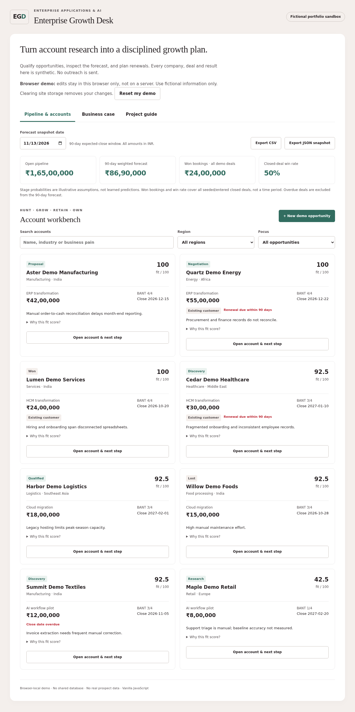

# Enterprise Growth Desk

A sales-operations portfolio sandbox for ERP, HCM, cloud and AI opportunities. Qualify fictional accounts, plan renewals, inspect a weighted forecast and build a customer business case.

> All companies, personas, deals and results are synthetic. Discovery briefs are rule-based, not generated by an AI model. This project demonstrates a workflow, not real sales achievements.

## Live demo

[Open the live demo](https://lokeshjatoth.github.io/enterprise-growth-desk/)

The hosted edition is a browser-local JavaScript demo. Each visitor starts with eight fictional opportunities. Edits and notes stay in that browser's storage, not in a shared server database. Clearing site storage or selecting **Reset my demo** removes those edits. Do not enter confidential information. No prospect data, API keys or sign-in are required.

The repository also includes the original local Python/SQLite edition. The hosted demo does not run the Python server or SQLite database.



## Workflow

| Area | Implemented capability |
| --- | --- |
| Hunt | Transparent account-fit score, search, region filters and BANT qualification |
| Grow and retain | Existing-customer flags, renewal dates, next steps and activity notes |
| Advise | Product-specific discovery questions and an illustrative ROI/payback calculator |
| Own | Stage-weighted 90-day forecast, overdue hygiene and CSV/JSON exports |

BANT means Budget, Authority, Need and Timeline. Qualified and later stages require at least three BANT fields, a decision maker, a next step, a close date and positive deal value. Lost opportunities require a reason. Stale opportunity saves are rejected.

## Try the demo in five minutes

1. Use the fixed scenario date **2026-11-13**. Filter to overdue opportunities.
2. Open **Summit Demo Textiles** and move its close date to **2026-12-05**. Save a specific fictional next step.
3. The weighted forecast increases from **INR 8,690,000 to INR 9,170,000**, because INR 1,200,000 at 40% moves into the forecast window.
4. Add an activity note, reload and confirm the change remains in your browser.
5. Open **Business case**. Default assumptions produce **92%** first-year ROI and **4.7 months** simple payback. Change adoption to 25% and explain why capacity value is not guaranteed cash savings.
6. Export a snapshot or reset your demo. A JSON export is a readable snapshot, not an import/restore feature.

## Run the Python/SQLite edition

Requires Python 3.10+ and a modern browser. No third-party runtime packages or API keys.

```sh
python3 app.py
```

Windows: run `py -3 app.py` or double-click `start_windows.bat`. macOS/Linux also have `start_mac_linux.sh`.

Open `http://127.0.0.1:8765` on the same computer. Keep the terminal running; Ctrl+C stops it. The app creates `growth-desk.sqlite3` on first launch. Database files are ignored by Git. Do not expose this local server to the internet: it is not a hardened multi-user CRM.

## Run the browser edition locally

```sh
python3 -m http.server 8000 --bind 127.0.0.1 --directory demo
```

Open `http://127.0.0.1:8000`. This serves static assets only; data is saved in the browser, not by this HTTP server. Do not open `demo/index.html` directly with a file URL.

## Tests

```sh
python3 -m unittest discover -s tests -v
node tests/demo_logic.cjs
```

The first command runs 22 Python logic, API and persistence tests. The second checks the browser model against Python-generated fixtures and tests qualification, date, numeric and ROI guardrails. Node is a development dependency, not required to run the application. GitHub Actions configuration runs both commands on pushes and pull requests; its hosted status must be checked after publication.

Optional Playwright checks cover filters, responsive layouts, edits, notes, validation, escaped text, exports, reload persistence, stale saves and isolated visitor contexts. See [test notes](docs/TEST_REPORT.md) for setup and validation scope.

## Model and architecture

- **Local edition:** standard-library Python HTTP server, SQLite, vanilla JavaScript.
- **Hosted edition:** static HTML/CSS/JavaScript, browser-local storage, no backend or third-party network integrations.
- **Forecast:** value multiplied by a chosen stage probability, limited to open deals closing within 90 days. Overdue deals are excluded. These are assumptions, not learned probabilities.
- **Fit score:** employee size up to 25, documented pain 25, decision maker 20, BANT completeness up to 30.
- **Business case:** annual capacity value = monthly hours x hourly cost x 12 x adoption. ROI compares first-year value with recurring and implementation costs. Payback excludes financing, taxes, risk and benefits ramp.

All amounts are INR; no live currency conversion occurs. Region names do not imply timezone or calendar integration. Won bookings and closed-deal win rate include all entered closed deals, not a stated reporting period. Renewal flags do not calculate customer-retention rates.

## Scope and limits

No live AI, account research, prospect scraping, outreach, SAP/SuccessFactors connector, commercial CRM integration, Sales Navigator integration, multi-user authentication, real customer wins or production revenue. The project is an educational portfolio sandbox, not an official product or employer-endorsed implementation.

Initial implementation and deployment preparation were AI-assisted. Anyone presenting it should run the practice workflow, understand the calculations and explain their own changes rather than claim unassisted authorship or enterprise-sales experience.

See the [role mapping](docs/ROLE_MAPPING.md), [interview guide](docs/INTERVIEW_GUIDE.md) and [local setup guide](docs/LOCAL_GUIDE.md).
